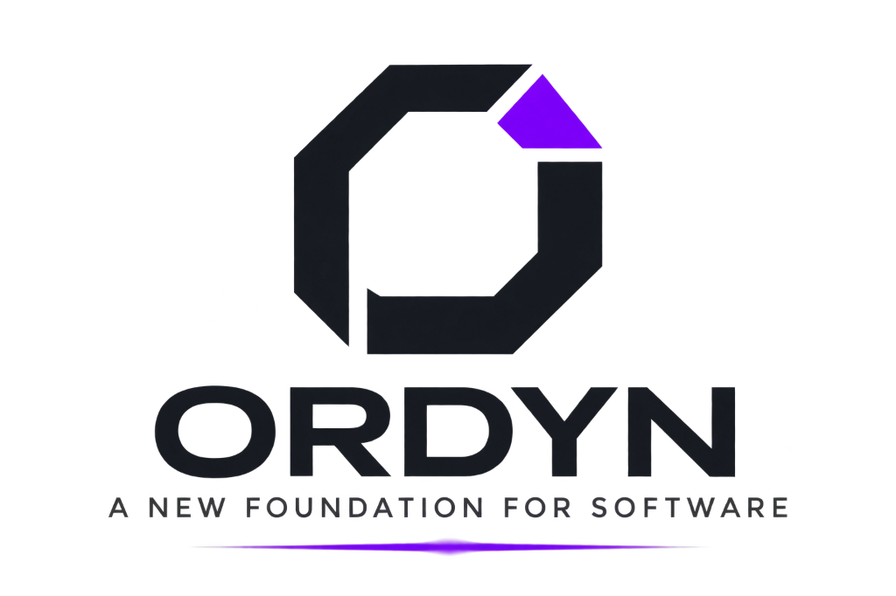

<p align="center">
  <picture>
    <source media="(prefers-color-scheme: dark)" srcset="assets/ordyn-banner-dark.png">
    
  </picture>
</p>

<p align="center">
  <strong>A New Foundation for Software.</strong><br/>
  <em>Security first. Engineered beyond code.</em>
</p>

<p align="center">
  <a href="https://github.com/M1k3lee/ORDYN/actions"></a>
  <a href="LICENSE"></a>
  <a href="docs/development/IMPLEMENTATION_STATUS.md"></a>
  <a href="https://m1k3lee.github.io/ORDYN/"></a>
</p>

---

## 🎯 Live Security Challenge: Hack the Sovereign Vault

> **Interactive Online Challenge:** Can you breach ORDYN's zero-ambient-authority boundary?  
> Launch real attack vectors (Capability Forgery, Lattice Widening, Contract Underflow, SSRF Egress, and ReDoS Starvation) directly against the ORDYN Security Kernel:  
> 🔗 **[Launch Interactive Challenge Website (m1k3lee.github.io/ORDYN)](https://m1k3lee.github.io/ORDYN/)**

- **Target Program:** [`examples/challenge_vault.ordyn`](examples/challenge_vault.ordyn) ($1,000,000 Zero-Day Bounty Reserve)
- **Local Runner:** `python demo/server.py` &rarr; `http://localhost:8088`
- **Features:** Real-time attack console, live architectural DAG explorer, custom payload compiler, and cryptographic audit trail receipts.

---

## Overview

ORDYN is a security-first programming language and sovereign computing platform designed for modern, verifiable software development. 

Traditional software ecosystems require developers to stitch together disparate languages, databases, authentication middleware, and network firewalls—each with independent security boundaries and vulnerabilities. ORDYN unifies these concerns into an integrated compiler, intermediate representation, runtime, and security architecture.

---

## Architectural Principles

1. **Security First:** Security is intrinsic to the compiler and runtime, not an optional library or afterthought.
2. **Zero Ambient Authority:** Privileged operations require explicit, unforgeable capabilities.
3. **Information-Flow Lattice:** Data classifications (`Public`, `Internal`, `Confidential`, `Restricted`) prevent unauthorized data leakage at compile time.
4. **Deterministic & Reproducible:** Identical inputs yield bit-for-bit identical compiled artifacts.
5. **AI-Audited, Never AI-Trusted:** AI tools assist developers in design and testing, but the Security Kernel and compiler enforce verification deterministically without AI authority.

---

## The Six Foundational Constructs

ORDYN organizes systems around six primary language constructs:

1. **`entity`**: Autonomous, stateful domain component.
2. **`capability`**: Unforgeable, typed token of authority.
3. **`contract`**: Formal preconditions, postconditions, and invariants.
4. **`flow`**: Declarative, verifiable data pipeline.
5. **`boundary`**: Isolated execution sandbox with resource quotas.
6. **`interface`**: Formally typed protocol for cross-boundary communication.

---

## Repository Structure

```text
/ORDYN
├── docs/
│   ├── architecture/
│   │   ├── SYSTEM_ARCHITECTURE.md
│   │   ├── COMPILER_ARCHITECTURE.md
│   │   ├── RUNTIME_ARCHITECTURE.md
│   │   └── SECURITY_ARCHITECTURE.md
│   ├── language/
│   │   ├── SPECIFICATION.md
│   │   ├── GRAMMAR.md
│   │   ├── TYPE_SYSTEM.md
│   │   ├── EFFECTS.md
│   │   ├── CAPABILITIES.md
│   │   └── CONTRACTS.md
│   ├── development/
│   │   ├── ROADMAP.md
│   │   ├── IMPLEMENTATION_STATUS.md
│   │   ├── DECISIONS.md
│   │   └── KNOWN_LIMITATIONS.md
│   ├── security/
│   │   ├── THREAT_MODEL.md
│   │   ├── FORMAL_ENGINEERING_RISK_ASSESSMENT.md
│   │   ├── SECURITY_TESTS.md
│   │   └── VERIFICATION_STATUS.md
│   └── contributing/
│       ├── CONTRIBUTING.md
│       └── RFC_PROCESS.md
├── crates/             # Rust Workspace Crate Packages (Compiler & Runtime)
├── examples/           # Canonical ORDYN Source Code Examples (.ordyn)
└── tests/              # End-to-End and Security Test Suites
```

---

## Documentation Navigation

- [System Architecture](file:///c:/Users/mike/ORDYN/docs/architecture/SYSTEM_ARCHITECTURE.md)
- [Compiler Architecture](file:///c:/Users/mike/ORDYN/docs/architecture/COMPILER_ARCHITECTURE.md)
- [Runtime Architecture](file:///c:/Users/mike/ORDYN/docs/architecture/RUNTIME_ARCHITECTURE.md)
- [Security Architecture](file:///c:/Users/mike/ORDYN/docs/architecture/SECURITY_ARCHITECTURE.md)
- [Language Specification](file:///c:/Users/mike/ORDYN/docs/language/SPECIFICATION.md)
- [Formal Grammar (EBNF)](file:///c:/Users/mike/ORDYN/docs/language/GRAMMAR.md)
- [Type System Specification](file:///c:/Users/mike/ORDYN/docs/language/TYPE_SYSTEM.md)
- [Effect System Specification](file:///c:/Users/mike/ORDYN/docs/language/EFFECTS.md)
- [Capability Model](file:///c:/Users/mike/ORDYN/docs/language/CAPABILITIES.md)
- [Contract Verification](file:///c:/Users/mike/ORDYN/docs/language/CONTRACTS.md)
- [Master Roadmap](file:///c:/Users/mike/ORDYN/docs/development/ROADMAP.md)
- [Implementation Status](file:///c:/Users/mike/ORDYN/docs/development/IMPLEMENTATION_STATUS.md)
- [Architecture Decisions (ADRs)](file:///c:/Users/mike/ORDYN/docs/development/DECISIONS.md)
- [Threat Model](file:///c:/Users/mike/ORDYN/docs/security/THREAT_MODEL.md)
- [Formal Engineering Risk Assessment](file:///c:/Users/mike/ORDYN/docs/security/FORMAL_ENGINEERING_RISK_ASSESSMENT.md)
