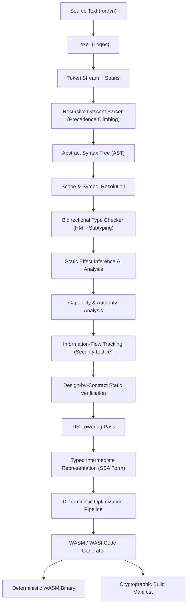

# ORDYN Compiler Architecture (ORDYN Core)

**Classification:** Compiler Specification & Pipeline Design  
**Target:** WebAssembly (WASM Core) / WASI Preview 2  
**Implementation Language:** Rust (Toolchain 1.80+)  

---

## 1. Overview & Pipeline Stages

The ORDYN compiler is structured as a strictly decoupled multi-pass pipeline. Each phase produces an immutable, validated representation that serves as the input to subsequent verification and transformation passes.

---

## 2. Pipeline Passes & Invariants

### 2.1 Lexical Analysis (`ordyn-lexer`)
- **Technology:** Implemented in Rust using zero-allocation token streaming with source span tracking (`miette` / `codespan` diagnostic compatibility).
- **Responsibilities:**
  - Tokenization of identifiers, keywords (`entity`, `capability`, `contract`, `flow`, `boundary`, `interface`, etc.), literals (integers, floats, strings, booleans, labels).
  - Tracking accurate byte offsets and line/column numbers for high-fidelity compiler diagnostics.
  - Rejecting non-UTF-8 characters, unterminated string literals, and malformed numeric literals early.

### 2.2 Parsing and AST (`ordyn-parser`, `ordyn-ast`)
- **Design:** Hand-written recursive descent with Pratt / precedence climbing for expressions.
- **Error Recovery:** Synchronization tokens (`entity`, `fn`, `flow`, `;`, `}`) allow the parser to discover and report multiple distinct syntax errors per file rather than halting on the first failure.
- **AST Nodes:** Pure algebraic data types (`enum` / `struct`) containing precise source spans for every declaration, statement, and expression.

### 2.3 Semantic Analysis & Type Checking (`ordyn-types`)
- **Model:** Bidirectional type inference based on Hindley-Milner with algebraic data types, records, strict null-safety (via `Option<T>`), and linear/affine ownership tracking for non-duplicable capability tokens.
- **Type Lattice:**
  - Primitive types: `Int`, `Float`, `Bool`, `String`, `Bytes`, `Unit`.
  - Nominal types: `Entity`, `Interface`.
  - Structural types: Algebraic Data Types (`enum`), Record structs.
  - Security Classifications: `Public`, `Internal`, `Confidential`, `Restricted`.

### 2.4 Effect Analysis (`ordyn-effects`)
- **Principle:** Every impure operation (I/O, network, mutation, non-determinism, state change) must declare an effect.
- **Syntax:** `fn transfer(...) -> Result<Unit, Error> with [Net, Storage, State]`
- Functions without an explicit `with [...]` clause are verified to be mathematically pure. Unhandled effects produce compile-time errors.

### 2.5 Capability Analysis (`ordyn-capabilities`)
- Privileged operations require unforgeable capability handles passed explicitly as parameters or bound to enclosing `entity` contexts.
- Affine capability tokens cannot be copied or duplicated. Once an affine capability is consumed in a linear operation (e.g., closing a connection or executing a financial transaction), subsequent use is rejected at compile time.

### 2.6 Information-Flow Analysis
- Implements decentralized label model (DLM).
- Variables, struct fields, and entity attributes carry security classifications:
  $$\text{Public} \sqsubseteq \text{Internal} \sqsubseteq \text{Confidential} \sqsubseteq \text{Restricted}$$
- Expressions combining labels produce the least upper bound ($\sqcup$):
  $$\text{Public} \sqcup \text{Confidential} = \text{Confidential}$$
- Declassification across boundaries requires a verified declassification contract and explicit capability authorization.

### 2.7 Contract Verification (`ordyn-contracts`)
- Checks `requires` (preconditions), `ensures` (postconditions), and `invariant` declarations.
- Simple arithmetic and boolean invariants are checked statically via abstract interpretation and interval arithmetic; complex invariants generate runtime assertion wrappers that cannot be stripped in production builds.

### 2.8 Typed Intermediate Representation (TIR) (`ordyn-ir`)
- Static Single Assignment (SSA) form with explicit basic blocks, control flow graphs (CFGs), and typed phi-nodes.
- Retains security labels and capability scopes, ensuring optimizations do not invalidate security boundaries or reorder capability checks before privileged actions.

### 2.9 Code Generation & Optimization
- **Target:** WebAssembly (WASM) 32-bit (wasm32-wasip2 / wasm32-unknown-unknown).
- Deterministic bytecode emission: removes timestamps, host paths, and non-deterministic map ordering to guarantee bit-for-bit reproducible builds.
- Manifest generation: Computes SHA-256 hashes of all input ASTs, dependencies, capabilities, and the output WASM module.
