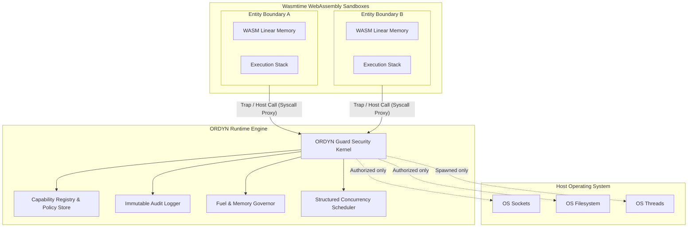

# ORDYN Runtime Architecture (ORDYN Runtime)

**Classification:** Execution Engine & Sandbox Host  
**Host Architecture:** Rust + Wasmtime  
**Isolation Model:** Shared-Nothing Sandboxed Instances with Capability Tables  

---

## 1. Architectural Mission

The ORDYN Runtime is responsible for executing compiled ORDYN artifacts (`.wasm`) within strictly constrained, isolated execution boundaries. It enforces security policies, tracks resource consumption (CPU instructions, memory allocations), schedules asynchronous tasks, and proxies all interaction with the external world (networks, disks, time, devices) through the **ORDYN Guard Security Kernel**.

---

## 2. Runtime Subsystems

---

## 3. Core Principles

### 3.1 Memory Safety and Zero Ambient Authority
- Applications execute inside standard WebAssembly linear memory sandboxes managed by Wasmtime.
- Linear memory is strictly bounds-checked by hardware page guards and WASM semantics; out-of-bounds pointer reads/writes trigger immediate trapped termination.
- Zero direct syscalls: The compiled bytecode contains no instructions capable of invoking OS kernel routines directly. All external operations are linked against ORDYN runtime imports (`ordyn_kernel_*`).

### 3.2 Capability Table and Handle Translation
- At initialization, the runtime parses the signed `.ordyn-manifest`.
- The Security Kernel validates the manifest signature against trusted public keys and populates an in-memory `CapabilityTable`.
- Unprivileged code only receives opaque, index-based handles (`CapHandle(u32)`). The actual permission, scope, and revocation status remain encapsulated inside the Kernel.
- Any host call verifying a handle inspects:
  1. Handle validity in the caller's capability table.
  2. Scope and constraints (e.g., target domain, directory path prefix, rate limit).
  3. Dynamic revocation state.
  4. Fuel budget.

### 3.3 Resource Limits & Fuel Accounting
- CPU execution is metered using WASM instruction fuel counters. Infinite loops or denial-of-service attempts consume their allocated fuel and trap deterministically.
- Memory growth is restricted by explicit ceiling limits declared in the build manifest.
- MicroVM / WebAssembly instances are short-lived or pooled, preventing slow memory leaks from threatening system availability.

### 3.4 Structured Concurrency
- Concurrency in ORDYN is organized into strictly bounded task trees (`nursery` / `scope`).
- A parent task cannot complete until all spawned child tasks complete or cancel.
- Cancellation propagates deterministically downwards; cancellation cannot be silently ignored or swallowed.

### 3.5 Immutable Audit Logging
- Every capability check, boundary crossing, authorization failure, and sensitive transaction emits a structured binary audit event.
- Audit records include:
  - Timestamp (UTC monotonic).
  - Calling entity identifier.
  - Requested capability ID.
  - Target resource URI / identifier.
  - Decision: `Granted`, `Denied`, or `Trapped`.
  - Content digest (SHA-256) of input arguments.
