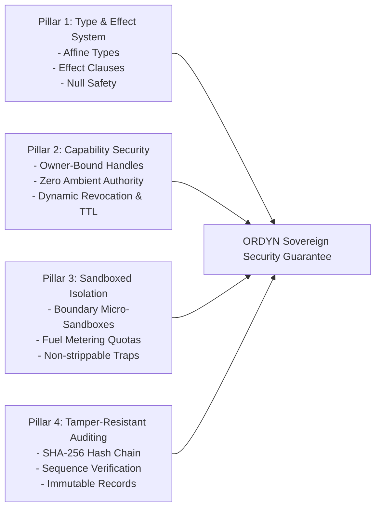

# ORDYN Security Architecture (ORDYN Guard)

**Classification:** Security Architecture & Threat Defense  
**Kernel Principle:** Principle of Least Privilege, Non-bypassable Enforcement, Tamper-Resistance, Explicit Audit  
**Baseline:** v0.1.0-alpha (Post-Adversarial Hardening)

---

## 1. Security Philosophy

ORDYN operates under an uncompromising security philosophy:

1. **Security is not an add-on:** Security invariants must be represented in language syntax, enforced by the compiler type system, validated during intermediate representation optimization, and policed at runtime by the security kernel.
2. **Untrusted Environment Assumption:** All external input, network communication, third-party packages, and AI agents are assumed to be adversarial or compromised.
3. **Defense-in-Depth:** A vulnerability in any single layer (e.g., an application logic flaw or compiler optimization bug) must be caught and mitigated by independent boundaries (capability tables, sandbox memory guards, fuel governors, kernel policies).
4. **Honest Claims:** ORDYN never claims to make applications "unhackable." Rather, it establishes clear mathematical invariants, defines concrete threat models, and produces independently reproducible verification artifacts.

---

## 2. Threat Model Baseline

### In-Scope Adversary Capabilities
- Compromised application interface attempting to invoke unauthorized backend operations.
- Cross-component capability theft (Component B presenting Component A's capability handle).
- Capability handle forgery and enumeration across $2^{64}$ address space.
- Authority expansion (attenuating a read-only capability into write/delete).
- Expired credential reuse (reusing a time-limited grant past its TTL).
- Audit log erasure or tampering.
- Memory corruption attempts and out-of-bounds contract violations.
- Denial-of-service via algorithmic complexity attacks and infinite loops.
- Prompt injection and malicious code generation from untrusted AI engineering tools.

### Out-of-Scope / Environmental Assumptions
- Physical compromise of host hardware (bus sniffing, cold boot attacks without hardware enclave).
- Malicious microcode or hardware errata in host CPU.
- Compromised host operating system kernel with root / ring-0 privileges.

---

## 3. Core Pillars of ORDYN Guard

### 3.1 Owner-Bound Capability Handles & Zero Ambience
- Capabilities are unforgeable tokens granting authority to invoke specific operations on specific resources.
- Every capability is registered in kernel memory with an explicit `owner_boundary`.
- In `SecurityKernel::authorize`, the kernel verifies that the caller identity matches the capability's registered owner or an explicitly authorized delegate.
- Attempts by a compromised component to use another component's handle trigger an immediate security trap (`KernelError::UnauthorizedCaller`).

### 3.2 Time-Limited Capabilities (TTL) & Dynamic Revocation
- Sensitive operational grants can be issued with explicit time-to-live (`expires_at_micros`).
- Any invocation past expiration fails with `KernelError::CapabilityExpired`.
- Monotonic attenuation guarantees child capabilities cannot exceed parent TTL.
- Cascading revocation atomically invalidates entire delegation trees via DAG traversal.

### 3.3 Cryptographic Hash-Chained Audit Trail
- Every access decision (Granted, Denied, Trapped) is committed to an append-only cryptographic hash chain:
  $$\text{RecordHash}_i = \text{SHA256}(\text{PrevHash}_{i-1} \parallel \text{Seq}_i \parallel \text{Timestamp} \parallel \text{Caller} \parallel \text{Handle} \parallel \text{Op} \parallel \text{Decision})$$
- The kernel provides `verify_audit_log()`, detecting any memory modification, deletion, or truncation of audit records.

### 3.4 Boundary Isolation & Contract Trapping
- Applications are decomposed into distinct architectural `boundary` sandboxes.
- Each boundary is allocated independent capability sets, fuel budgets, and state storage.
- Function pre- and postconditions are compiled into non-strippable runtime assertion envelopes (`ContractAssert`).

---

## 4. Industrial Infrastructure Reference Architecture (Supermarket Case Study)

In critical infrastructure applications (such as a 150-unit supermarket refrigeration management system):
- **Telemetry Boundary:** Possesses read-only telemetry capabilities (`store/14/telemetry/`).
- **Defrost Scheduler Boundary:** Holds rate-limited defrost control capabilities.
- **Compressor Governor Boundary:** Holds write capabilities restricted by formal contract (`temp >= -25 && temp <= -15`).
- **Independent Alarm Boundary:** Out-of-band alarm dispatch with non-revocable authority.
- **Exposed Dashboard Boundary:** View-only telemetry capability; zero hardware write authority.

Even if an attacker gains full remote code execution inside the Dashboard:
1. They cannot adjust compressor setpoints (blocked by missing write capability).
2. They cannot steal the compressor governor's handle (blocked by caller ownership check).
3. They cannot silence independent safety alarms (blocked by boundary isolation).
4. They cannot control other store branches (blocked by resource prefix scoping).
5. They cannot set out-of-range temperatures (blocked by runtime contract traps).
6. They cannot erase audit logs (blocked by cryptographic hash chaining).
