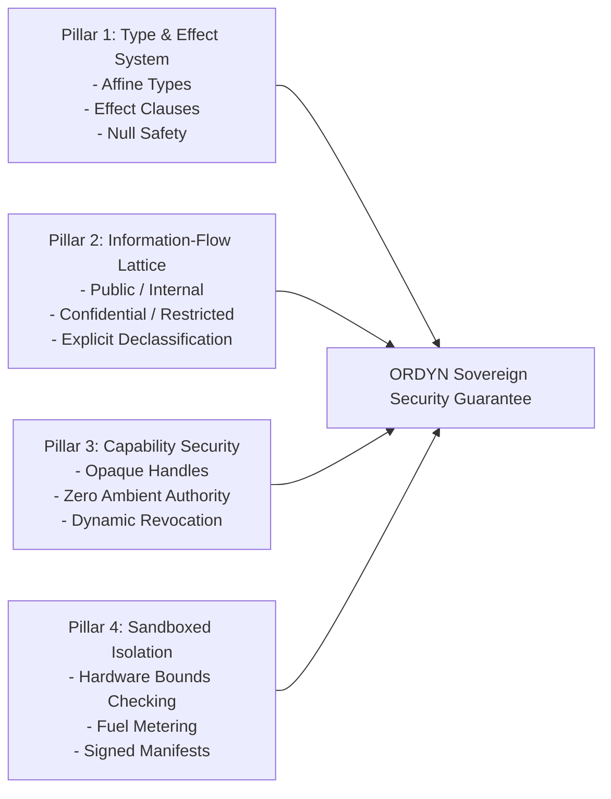

# ORDYN Security Architecture (ORDYN Guard)

**Classification:** Security Architecture & Threat Defense  
**Kernel Principle:** Principle of Least Privilege, Non-bypassable Enforcement, Tamper-Resistance, Explicit Audit  

---

## 1. Security Philosophy

ORDYN operates under an uncompromising security philosophy:

1. **Security is not an add-on:** Security invariants must be represented in language syntax, enforced by the compiler type system, validated during intermediate representation optimization, and policed at runtime by the security kernel.
2. **Untrusted Environment Assumption:** All external input, network communication, third-party packages, and AI agents are assumed to be adversarial or compromised.
3. **Defense-in-Depth:** A vulnerability in any single layer (e.g., an application logic flaw or compiler optimization bug) must be caught and mitigated by independent boundaries (capability tables, sandbox memory guards, fuel governors, kernel policies).
4. **Honest Claims:** ORDYN never claims to make applications "unhackable." Rather, it establishes clear mathematical invariants, defines concrete threat models, and produces independently reproducible verification artifacts.

---

## 2. Threat Model Baseline

### In-Scope Adversary Capabilities
- Arbitrary untrusted input over network interfaces.
- Supply-chain attacks via third-party package dependencies.
- Memory corruption attempts (buffer overflows, use-after-free, double free, type confusion).
- Unauthorized data exfiltration across logical boundaries (side channels, covert storage channels, unauthorized API calls).
- Denial-of-service via algorithmic complexity attacks, infinite loops, and thread starvation.
- Prompt injection and malicious code generation from AI engineering tools.

### Out-of-Scope / Environmental Assumptions
- Physical compromise of host hardware (bus sniffing, cold boot attacks without hardware enclave).
- Malicious microcode or hardware errata in host CPU.
- Compromised host operating system kernel with root / ring-0 privileges.

---

## 3. Four Pillars of ORDYN Security

### 3.1 Information-Flow Security Lattice
All data elements in ORDYN have an attached classification label forming a bounded join-semilattice:

$$\text{Public} \sqsubseteq \text{Internal} \sqsubseteq \text{Confidential} \sqsubseteq \text{Restricted}$$

Rules:
- Information can flow freely upwards: a `Public` value may be assigned to a `Confidential` variable.
- Information cannot flow downwards without an explicit declassification boundary:
  $$\text{Declassify}(x, \text{with: DeclassifyCap}) \rightarrow y$$
- Declassification operations require a specialized, audited capability and must satisfy precondition contracts.

### 3.2 Opaque Capability Handles
- Capabilities are unforgeable tokens granting authority to invoke specific operations on specific resources.
- Inside user code, a capability is an affine (use-once or linear) value.
- At the runtime level, capabilities are stored inside an isolated kernel table. User WASM memory contains only an unforgeable 32-bit handle ID.
- Attempts to synthesize handles out of arbitrary integers trigger immediate runtime traps and audit logging.

### 3.3 Boundary Isolation & Micro-Sandboxing
- Complex applications are decomposed into distinct **Entities** and **Boundaries**.
- An entity can only communicate with entities across a boundary through typed **Interfaces** and validated **Contracts**.
- If an entity is compromised or triggers a runtime panic, the blast radius is restricted to that entity's boundary instance. Other entities continue normal operation.

### 3.4 AI Safety & Containment
- AI systems and autonomous agents operate strictly outside the Trusted Computing Base (TCB).
- AI agents cannot commit changes directly to production without passing static type checking, contract verification, capability audits, and deterministic compilation.
- AI models are never queried at runtime to make security or authorization decisions.
