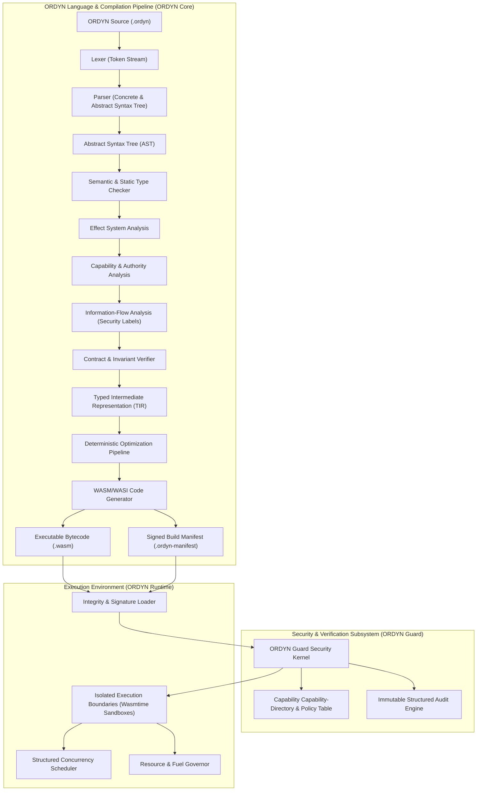

# ORDYN System Architecture

**Classification:** Open-Source Computing Infrastructure  
**Status:** Architecture Baseline (Draft v0.1.0)  
**Security Level:** Kernel-Enforced Boundary Isolation  

---

## 1. Executive Summary

ORDYN is a security-first, statically typed programming language and sovereign computing platform. Unlike conventional application stacks—where security is an extrinsic layer composed of ad-hoc middleware, network policies, third-party libraries, and operating system permissions—ORDYN treats security, information flow, memory safety, and capability enforcement as intrinsic primitives of the compiler and execution runtime.

The system is organized into a modular pipeline where program semantics are statically checked, capabilities are cryptographically and structurally validated, effects are tracked at type level, and execution is isolated within sandboxed boundaries governed by a minimal Trusted Computing Base (TCB): the **ORDYN Guard Security Kernel**.

---

## 2. High-Level System Architecture

The following diagram illustrates the complete end-to-end processing pipeline from source code to sandboxed execution:

---

## 3. Product Ecosystem Components

ORDYN is partitioned into distinct, independently testable architectural components:

| Component | Role | Security Invariant |
|---|---|---|
| **ORDYN Lang** | Language syntax, grammar, AST, and semantic definitions. | Deterministic, unambiguous language specification. |
| **ORDYN Core** | Compiler, type checker, effect analyzer, information-flow verifier, TIR, and optimizer. | Deterministic compilation; rejects unauthorized effects/flows at compile time. |
| **ORDYN Guard** | Security kernel, capability authority, policy enforcement, cryptographic verification. | Minimal TCB; tamper-proof capability tokens; immutable audit logs. |
| **ORDYN Runtime** | Sandbox host, WASM runtime (Wasmtime engine), structured concurrency, lifecycle management. | Strict hardware/OS isolation; no ambient authority; zero direct syscall access. |
| **ORDYN CLI** | Developer interface (`ordyn new`, `ordyn build`, `ordyn verify`, `ordyn run`). | Reproducible developer tooling; non-interactive scriptability. |
| **ORDYN Forge** | Secure package registry, dependency capability analysis, signature attestation. | Zero implicit authority for third-party packages; verified provenance. |
| **ORDYN Red Lab** | Automated adversarial fuzzing, contract mutation testing, and sandbox breakout validation. | Continuous automated verification against adversarial models. |

---

## 4. Architectural Invariants

1. **Zero Ambient Authority:** A component possesses only the capabilities explicitly granted to it during instantiation. Direct operating system calls, memory-mapped I/O, network sockets, and filesystem handles do not exist in the unprivileged execution space.
2. **Compile-Time Static Enforcement First:** All security policies, information-flow labels, and effect budgets that can be resolved statically are validated during compilation. Runtime enforcement acts as defense-in-depth, not as a replacement for static type and effect verification.
3. **Information Flow Lattice:** All data carries a static security classification (`Public` $\sqsubseteq$ `Internal` $\sqsubseteq$ `Confidential` $\sqsubseteq$ `Restricted`). Information flow cannot leak from a higher classification to a lower classification without an explicit, capability-governed declassification boundary.
4. **Deterministic Reproducibility:** Identical compiler inputs, target configurations, and toolchain versions must produce bit-for-bit identical compiled artifacts and signed manifests.
5. **No AI in the Trusted Computing Base:** AI agents and reasoning tools assist developers in authoring code, analyzing performance, and constructing tests, but AI outputs are treated as untrusted user input. The Security Kernel and Compiler never consult an AI model to evaluate policy, capability, or contract validity.
