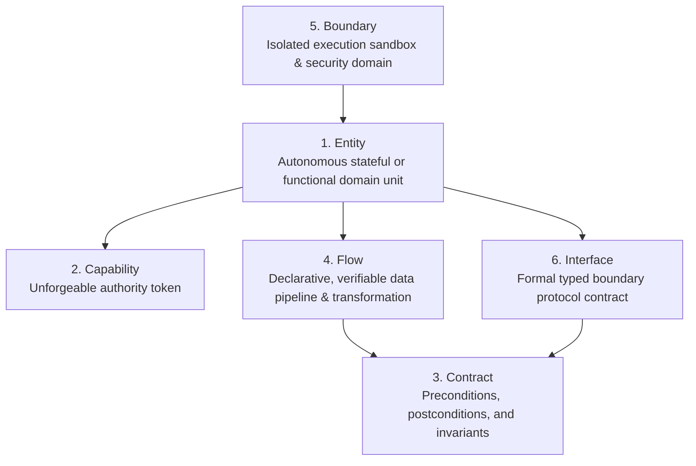

# ORDYN Language Specification

**Version:** 0.1.0-alpha  
**Status:** Baseline Specification  
**Authors:** ORDYN Systems Architecture & Compiler Engineering Group  

---

## 1. Introduction

ORDYN is a statically typed, security-first programming language designed for verifiable, robust systems and cloud infrastructure. It blends structured functional and nominal programming with explicit effect tracking, capability-based security, and architectural boundary isolation.

---

## 2. Lexical Structure

### 2.1 Character Set & Encoding
- ORDYN source code must be valid UTF-8. Non-UTF-8 bytes result in a compile error.
- Whitespace consists of spaces (`U+0020`), tabs (`U+0009`), and newlines (`\r`, `\n`). Whitespace is not semantically significant except to delimit tokens.

### 2.2 Comments
- Line comments begin with `//` and extend to the end of the line.
- Block comments begin with `/*` and terminate with `*/`. Block comments may be nested.
- Documentation comments begin with `///` and are attached to the subsequent declaration in the AST.

### 2.3 Identifiers
- Identifiers begin with an ASCII letter (`a-z`, `A-Z`) or underscore `_`, followed by letters, digits (`0-9`), or underscores.
- Names starting with an uppercase letter are conventionally reserved for nominal types (`Entity`, `Interface`, `Type`, `Enum`).
- Names starting with a lowercase letter are used for functions, variables, fields, and capability names.

### 2.4 Reserved Keywords
```text
entity       capability   contract     flow         boundary     interface
fn           let          mut          if           else         match
return       with         requires     ensures      invariant    type
enum         struct       pub          priv         true         false
none         some         import       as           yield        await
```

---

## 3. The Six Foundational Constructs

ORDYN introduces six first-class foundational constructs to unify language semantics with systems security:



### 3.1 Entity
An `entity` represents a cohesive domain or system component with encapsulated state, typed interfaces, and explicit capability bindings.
```ordyn
entity BankAccount {
    let id: String;
    mut balance: Int;

    pub fn deposit(amount: Int) -> Result<Int, Error>
        requires amount > 0
        ensures self.balance >= old(self.balance)
    {
        self.balance = self.balance + amount;
        return Ok(self.balance);
    }
}
```

### 3.2 Capability
A `capability` specifies an unforgeable permission to execute privileged actions or access guarded resources.
```ordyn
capability NetConnect {
    host: String;
    port: Int;
}

capability StorageWrite {
    path_prefix: String;
}
```

### 3.3 Contract
A `contract` specifies formal guarantees over functions, methods, and types using `requires`, `ensures`, and `invariant` clauses.
```ordyn
contract PositiveBalance {
    invariant balance >= 0;
}
```

### 3.4 Flow
A `flow` defines an ordered, verifiable pipeline of data transformations where security classifications and capabilities are statically tracked.
```ordyn
flow ProcessPayment(req: PaymentRequest, cap: NetConnect) -> Result<Receipt, Error> {
    validate(req)
        -> debit(req.amount)
        -> log_audit(req.id)
}
```

### 3.5 Boundary
A `boundary` defines an isolated execution partition (sandboxed instance) with explicit capability grants and resource quotas.
```ordyn
boundary PaymentGateway {
    grant NetConnect { host: "api.payment.internal", port: 443 };
    quota {
        memory_limit: 64MB;
        fuel_limit: 10000000;
    }
}
```

### 3.6 Interface
An `interface` specifies a typed contract for cross-boundary communication without exposing internal implementation details or private state.
```ordyn
interface PaymentService {
    fn charge(customer_id: String, amount: Int) -> Result<TransactionId, Error>
        with [NetConnect];
}
```

---

## 4. Type System & Semantics

### 4.1 Primitive Types
- `Int`: 64-bit signed integer (`i64`).
- `Float`: 64-bit IEEE 754 floating-point (`f64`).
- `Bool`: Boolean value (`true` or `false`).
- `String`: Immutable UTF-8 text string.
- `Bytes`: Immutable binary byte array.
- `Unit`: The empty unit tuple `()`.

### 4.2 Strict Null-Safety
ORDYN has no `null`, `nil`, or `undefined` values. Optionality is modeled exclusively using the algebraic data type `Option<T>`:
```ordyn
enum Option<T> {
    Some(T),
    None,
}
```

### 4.3 Error Handling
Fallible operations return `Result<T, E>`:
```ordyn
enum Result<T, E> {
    Ok(T),
    Err(E),
}
```
Unhandled errors must be explicitly propagated using `?` or resolved via pattern matching `match`.
