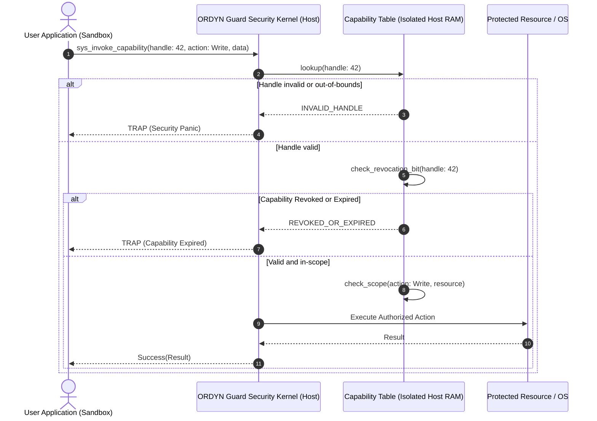
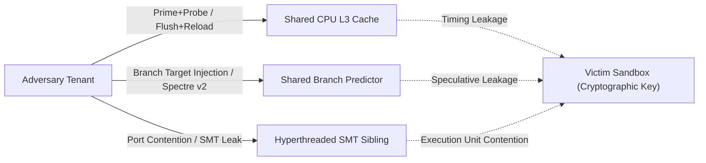
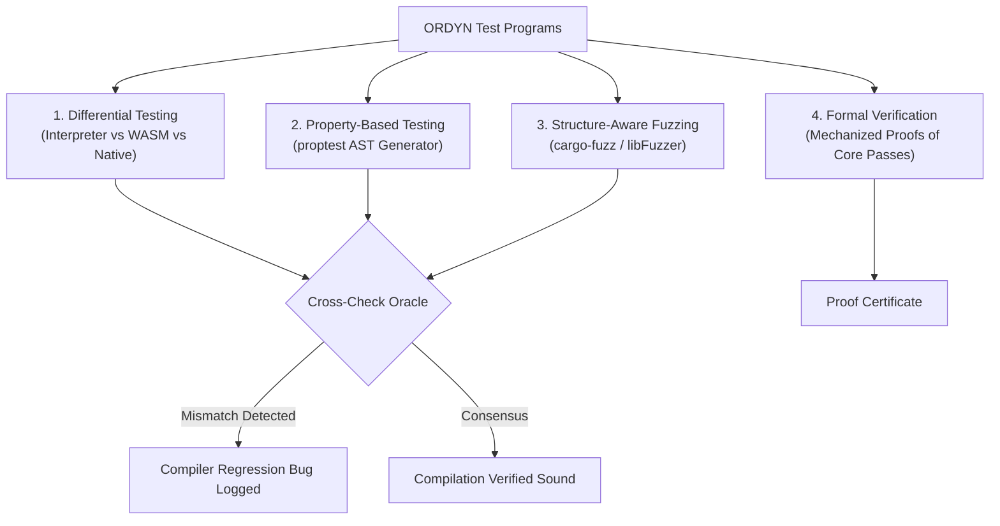
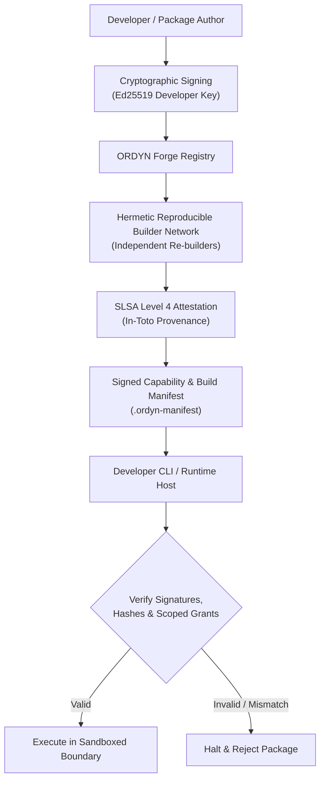

# ORDYN Formal Engineering Risk Assessment & Defense Baseline

**Classification:** High-Assurance Systems Engineering & Threat Architecture  
**Document ID:** ORDYN-SECRISK-2026-v0.1  
**Status:** Approved Engineering Baseline  
**Scope:** Compiler (`ORDYN Core`), Security Kernel (`ORDYN Guard`), Execution Host (`ORDYN Runtime`), Package System (`ORDYN Forge`)  

---

## 1. Executive Summary & Methodology

This document establishes the formal engineering risk assessment, threat model extensions, and verification baseline for the ORDYN computing platform. 

In strict adherence to the **ORDYN Founding Principles** (Section 3) and **Operating Rules** (Section 16), this document:
1. Rejects marketing claims of "unhackability" and instead defines concrete mathematical and architectural guarantees.
2. Formally distinguishes between **proven security invariants**, **defense-in-depth mitigations**, and **known residual risks**.
3. Exposes unresolved architectural trade-offs, potential failure modes, and required verification criteria before significant compiler and runtime implementation.

---

## 2. Risk Matrix & Classification Standards

All engineering risks within this document are classified according to standard high-assurance criteria:

| Severity Level | Definition |
|---|---|
| **Critical** | Compromise of the Trusted Computing Base (TCB), capability forgery, arbitrary host code execution, or silent leakage of `Restricted` information. |
| **High** | Cross-boundary privilege escalation, bypass of un-discharged runtime contracts, or supply-chain package tampering. |
| **Medium** | Micro-architectural side-channel leakage across co-located tenants, or algorithmic denial of service escaping fuel metering. |
| **Low** | Minor compiler panic on malformed source, localized single-task crash, or diagnostic misattribution. |

Status taxonomy for mitigations:
- **Implemented:** Code is written, reviewed, and covered by passing automated regression tests.
- **Planned:** Architecture is specified in formal ADRs and grammar; implementation scheduled in the Master Roadmap.
- **Theoretical:** Active research area; requires empirical prototyping or formal proof before committing to production interfaces.

---

## 3. Formal Deep Dive into the Seven Core Security Domains

```mermaid
flowchart TD
    subgraph D1["1. Contract Verification"]
        CP["Statically Proven (SVal)"]
        CR["Runtime Guarded (RGrd)"]
        CU["Unverified (Rejected)"]
    end

    subgraph D2["2. Capability Attenuation"]
        CAP_BASE["Base Capability Handle"]
        CAP_ATT["Monotonic Attenuation (Lattice Meet)"]
        CAP_REV["Epoch / Tree Revocation"]
        CAP_BASE --> CAP_ATT
        CAP_ATT --> CAP_REV
    end

    subgraph D3["3. WASM Execution"]
        INTERP["Interpreter (Low Perf / High Isolation)"]
        JIT["JIT (High Perf / Vulnerability Surface)"]
        AOT["AOT (Ahead-of-Time Precompilation + W^X)"]
    end

    subgraph D4["4. Side-Channel Resistance"]
        CLOCK["Jittered / Quantized Clocks"]
        CACHE["Cache Partitioning & Constant Time"]
        SPEC["Speculative Load Hardening & LFENCE"]
    end

    subgraph D5["5. Trusted Computing Base (TCB)"]
        TCB_K["ORDYN Guard Kernel"]
        TCB_C["ORDYN Compiler & TIR"]
        TCB_R["Wasmtime Runtime Host"]
        TCB_H["Host OS & Hardware MMU"]
    end

    subgraph D6["6. Compiler Correctness"]
        DIFF["Differential Testing"]
        PROP["Property-Based Testing"]
        FUZZ["Structure-Aware Fuzzing"]
        FORMAL["Mechanized Proofs"]
    end

    subgraph D7["7. Supply-Chain Security"]
        SLSA["SLSA Level 4 Attestation"]
        REC["Deterministic Reproducible Builds"]
        CAP_MAN["Explicit Scoped Dependency Grants"]
    end
```



---

## 4. Domain 1: Contract Verification Semantics

### 4.1 Tri-State Contract Taxonomy
ORDYN eliminates the ambiguity between compile-time proof and runtime assertions by establishing three mutually exclusive contract states in the Typed Intermediate Representation (TIR):

```
                     ┌───────────────────────────────────────────────┐
                     │          Contract Condition C(x)              │
                     └──────────────────────┬────────────────────────┘
                                            │
                        ┌───────────────────┴───────────────────┐
                        │   Abstract Interpreter / SMT Solver   │
                        └───────────────────┬───────────────────┘
                                            │
         ┌──────────────────────────────────┼──────────────────────────────────┐
         ▼                                  ▼                                  ▼
┌──────────────────┐              ┌──────────────────┐               ┌──────────────────┐
│ Statically Proven│              │ Runtime-Enforced │               │    Unverified    │
│      (SVal)      │              │      (RGrd)      │               │     (Unver)      │
├──────────────────┤              ├──────────────────┤               ├──────────────────┤
│ Formal proof     │              │ Non-strippable   │               │ Fails static     │
│ witness emitted; │              │ defensive trap   │               │ proof and static │
│ zero runtime     │              │ barrier emitted; │               │ guarantee is     │
│ overhead.        │              │ audits on abort. │               │ requested: ERROR.│
└──────────────────┘              └──────────────────┘               └──────────────────┘
```

1. **Statically Proven Contract ($\text{SVal}$):**
   - **Definition:** A contract clause whose condition $P(x)$ is formally discharged across all possible valid input values and execution paths by static abstract interpretation (interval arithmetic, octagonal domains) or bounded SMT solver deduction with zero free, unconstrained variables.
   - **TIR Representation:** `ContractProofStatus::StaticallyProven(ProofWitness)`.
   - **Execution Impact:** The condition is verified at compile time. No runtime checks or branching instructions are emitted into the generated WebAssembly bytecode.

2. **Runtime-Enforced Contract ($\text{RGrd}$):**
   - **Definition:** A contract clause whose truth cannot be proven statically across all program paths (e.g., dependent on external network payloads, non-linear arithmetic, or complex collection invariants).
   - **TIR Representation:** `ContractProofStatus::RuntimeGuarded(TrapLocation)`.
   - **Execution Impact:** The compiler emits an un-bypassable runtime assertion envelope. If the condition evaluates to `false` at entry (`requires`) or exit (`ensures`), the sandbox triggers an uncatchable WebAssembly trap (`unreachable`), terminates the boundary instance, and logs an immutable audit event.
   - **Invariance Rule:** Runtime contract checks **cannot be stripped** by release-mode compiler optimization flags.

3. **Unverified Contract ($\text{Unver}$):**
   - **Definition:** A contract clause marked with a static verification pragma (`#![require_static_proof]`) whose formal proof cannot be discharged, or a contract whose evaluation requires effects/capabilities not possessed by the contract scope.
   - **Compiler Enforcement:** The compiler **strictly rejects** the program with a compile-time fatal diagnostic (`E0501: Contract cannot be verified statically`).
   - **Prevention of False Proof Claims:** Unverified conditions are never assigned a `ProofWitness`. The TIR validator enforces that an instruction block marked `Proven` must point to an explicit proof certificate derived from verified AST nodes.

### 4.2 Risk Analysis: Contract Verification

| Field | Analysis |
|---|---|
| **Threat & Potential Impact** | **Soundness Bug in Static Verifier:** A flawed abstract interpretation pass falsely marks an invalid invariant as `StaticallyProven`. The compiler omits runtime assertion checks, allowing corrupted or unauthorized state to propagate undetected across an entity boundary. |
| **Likelihood & Severity** | Likelihood: Medium | Severity: Critical |
| **Proposed Mitigation** | 1. Implement proof witnesses: The static analyzer does not merely produce a boolean `true`, but emits a traceable step-by-step certificate of deduction.<br>2. Verification isolation: The contract verifier operates as a strictly validated compiler pass with defensive bounds checking.<br>3. Differential checking: Run both static proof and dynamic wrappers in `test` builds; any divergence between static proof and dynamic execution triggers a compiler-soundness bug report. |
| **Residual Risk** | Bounded SMT solver timeouts or incomplete theories for complex non-linear arithmetic ($x \times y \pmod n$) forcing fallbacks to runtime checks. |
| **Verification Method** | Mutation testing of contract clauses: invert conditions and verify that the compiler either rejects the static proof or triggers a runtime trap. |
| **Mitigation Status** | **Planned** (M1 Phase 2 & M2). |

---

## 5. Domain 2: Capability Attenuation & Lifecycle Model

### 5.1 Formal Mathematical Attenuation Model
Capabilities in ORDYN follow an Object Capability (OCap) bounded meet-semilattice:

$$\mathcal{C} = \langle \mathcal{P}(\text{Operations}) \times \text{ResourceConstraints} \times \text{Epoch}, \sqsubseteq \rangle$$

Let a capability $C = \langle \text{Ops}, \text{Res}, \text{Epoch} \rangle$. An attenuation transformation $f_\text{att}(C, \Delta) \rightarrow C'$ is valid if and only if:

$$\text{Ops}(C') \subseteq \text{Ops}(C) \quad \land \quad \text{Res}(C') \sqsubseteq \text{Res}(C) \quad \land \quad \text{Epoch}(C') = \text{Epoch}(C)$$

**Monotonic Authority Reduction Theorem:**  
Under no operation can $C'$ hold authority not possessed by $C$:
$$\text{Authority}(C') \le \text{Authority}(C)$$
Any attempt to expand operations ($\text{Ops}(C') \not\subseteq \text{Ops}(C)$) or broaden resource scopes ($\text{Res}(C') \not\sqsubseteq \text{Res}(C)$) results in an immediate compile-time rejection or runtime capability violation trap.

### 5.2 Capability Lifecycle, Handles, and Revocation



1. **Unforgeable Handles:**
   - User-space WebAssembly instances never hold pointers, addresses, or bit-patterns of capability data structures.
   - User space holds only a typed opaque 32-bit handle (`CapHandle(u32)`).
   - The handle is an index into the calling boundary's private `CapabilityTable` residing in host kernel memory.
   - Forged integers (guessing a random number like `0x0000002A`) fail lookup validation and trigger an uncatchable security trap.

2. **Revocation Architecture:**
   - **Epoch & Generation Counters:** Every capability entry holds a generation counter. Revoking a capability increments the generation counter, immediately invalidating all outstanding derived handles.
   - **Cascading Revocation Trees:** Capabilities delegated from a parent boundary to a child boundary form a directed acyclic delegation tree. Revoking the parent handle walks the tree and atomically invalidates all descendent handles.
   - **Bitmap Invalidation:** High-frequency revocations flip bits in an atomic bitset queried during handle resolution.

3. **Prevention of Ambient Authority:**
   - The runtime imports table for a compiled module exposes zero ambient primitives: no `open_file()`, no `create_socket()`, no `get_current_time()`.
   - Every system call requires an explicit `CapHandle` argument. If an entity does not receive a capability at boundary instantiation, it has zero mechanism to access that resource.

### 5.3 Risk Analysis: Capability Attenuation

| Field | Analysis |
|---|---|
| **Threat & Potential Impact** | **Confused Deputy & Authority Amplification:** A malicious entity passes a restricted capability handle to a privileged helper entity, causing the helper to execute privileged operations using its own ambient authority instead of the restricted capability's scope. |
| **Likelihood & Severity** | Likelihood: Medium | Severity: Critical |
| **Proposed Mitigation** | 1. Pure capability passing: Helpers operate strictly using caller-provided capabilities; entities have zero ambient authority.<br>2. Context-bound capability checking: The Security Kernel verifies that the capability handle presented matches both the caller identity and the intended target resource URI.<br>3. Linear/affine tracking in type checker: Affine capabilities cannot be duplicated or shared across unauthorized scopes. |
| **Residual Risk** | Denial-of-service via cascading revocation: Revoking a shared parent capability could abruptly invalidate critical dependent entities if isolation topologies are poorly designed. |
| **Verification Method** | 1. Adversarial fuzzing of synthetic capability handles.<br>2. Unit tests asserting that attempts to widen attenuation parameters produce compiler error `E0403: Illegal authority expansion`. |
| **Mitigation Status** | **Planned** (M3 Security Foundations). |

---

## 6. Domain 3: WebAssembly Execution Engine Security

### 6.1 Evaluation of Execution Strategies

| Execution Strategy | Performance Profile | Vulnerability Surface | Determinism & Fuel Metering | Suitability for ORDYN |
|---|---|---|---|---|
| **1. Pure Interpreter** | 10x – 50x slowdown relative to native. High latency. | **Minimal.** Zero dynamic native code generation (`W^X` strictly static). Memory safe. | **Absolute.** Exact instruction-by-instruction cycle accounting without JIT variance. | Suitable for high-security, low-throughput micro-kernels and verification nodes. |
| **2. Just-In-Time (JIT) Compilation** | Near-native speed (1.0x – 1.5x of C). Fast startup. | **Elevated.** Emits native machine code to memory at runtime. Vulnerable to JIT compiler flaws, code-injection, and JIT-spray attacks. | **Moderate.** Fuel metering requires injected counter checks which can be bypassed if JIT optimizer reorders basic blocks. | Rejected for primary secure kernel execution. |
| **3. Ahead-Of-Time (AOT) Compilation** | **Optimal.** Zero startup JIT overhead; near-native execution speed. | **Low.** Bytecode is compiled to native machine code (`.so` / `.dll`) before runtime invocation. Memory pages mapped executable are **never** writable (`W^X`). | **High.** Instruction fuel checks and memory bounds are statically compiled into deterministic basic blocks. | **Selected Baseline Strategy** for production runtime deployments. |

### 6.2 Security of Compiled Artifact Caching & Native Code Generation

1. **Content-Addressable Storage (CAS) Caching:**
   - AOT compiled native modules are stored in a cryptographically isolated cache keyed by:
     $$\text{CacheKey} = \text{HMAC-SHA256}\Big(\text{WASM\_Hash} \mathbin{\Vert} \text{Compiler\_Version} \mathbin{\Vert} \text{Target\_Triple} \mathbin{\Vert} \text{Build\_Flags}\Big)$$
   - The cache entry contains a cryptographic signature signed by the build environment key.

2. **Strict Immutable Memory Pages ($W \oplus X$):**
   - The runtime utilizes operating system MMU page guards (`VirtualProtect` on Windows, `mprotect` on POSIX).
   - Code segments are loaded as `PAGE_EXECUTE_READ` and never receive `PAGE_READWRITE` permissions during execution.
   - Writable linear memory is strictly segregated from code pages.

### 6.3 Risk Analysis: WASM Execution Engine

| Field | Analysis |
|---|---|
| **Threat & Potential Impact** | **JIT/AOT Code Generation Vulnerability in Runtime Engine:** A flaw in the Wasmtime/Cranelift code generator generates invalid machine code (e.g. failing to emit an address bounds check), allowing unprivileged WASM linear memory to escape and read/write arbitrary host memory. |
| **Likelihood & Severity** | Likelihood: Low | Severity: Critical |
| **Proposed Mitigation** | 1. Utilize Bytecode Alliance audited releases of Wasmtime with hardware guard pages (4GB virtual memory guard zones surrounding each WASM instance).<br>2. Double-bounds checking: both virtual address guard pages and explicit branch bounds checks.<br>3. Continuous fuzzing of Cranelift backend with `wasm-smith` and `cargo-fuzz`. |
| **Residual Risk** | Undiscovered zero-day vulnerability in host OS virtual memory management or CPU TLB invalidation. |
| **Verification Method** | Out-of-bounds pointer execution test suite attempting to read past linear memory limits; assert deterministic SIGSEGV / trap capture. |
| **Mitigation Status** | **Planned** (M4 Compiler & Execution). |

---

## 7. Domain 4: Comprehensive Side-Channel Resistance

### 7.1 Threat Model Expansion
Beyond naive high-resolution wall-clock timers, modern multi-tenant systems face sophisticated micro-architectural leakage channels:



1. **Speculative Execution (Spectre v1, v2, v4):**
   - *Threat:* The host CPU speculatively executes instructions past a capability bounds check before the check completes, pulling sensitive host or cross-tenant data into the micro-architectural cache.
   - *Mitigation:* Speculative Load Hardening (SLH) and memory fence (`lfence`) insertion after boundary security checks.

2. **Cache Timing (Flush+Reload, Prime+Probe):**
   - *Threat:* An attacker measures the access latency of memory lookups to infer cache hits, reconstructing secret keys or private entity states.
   - *Mitigation:* Constant-time execution paths for all cryptographic operations, security-sensitive equality comparisons, and secret-dependent array indices.

3. **Shared SMT / Hyperthreading Resources:**
   - *Threat:* Co-located worker threads sharing physical execution pipelines leak register and execution-unit state across hyperthreads.
   - *Mitigation:* High-assurance boundaries are scheduled exclusively on dedicated physical CPU cores with SMT disabled.

### 7.2 Clear Demarcation: Guarantees vs. Mitigations

> [!CAUTION]
> **Defensive Engineering Honesty:**  
> Software alone cannot eliminate all hardware-level side-channel attacks on general-purpose commodity processors. We explicitly distinguish between **architectural guarantees** and **defense-in-depth mitigations**.

| Dimension | Architectural Guarantee (Enforced) | Defense-in-Depth Mitigation (Best-Effort) |
|---|---|---|
| **Memory Isolation** | **GUARANTEED:** Software-enforced bounds and hardware MMU guard pages prevent direct memory reads/writes outside sandbox. | N/A |
| **High-Resolution Timing** | **GUARANTEED:** No clock instruction with resolution finer than 1ms is exposed inside the sandbox. | Added randomized jitter ($\pm 100\mu s$) to clock reads. |
| **Speculative Bounds** | **GUARANTEED:** Linear memory accesses clamped using bitwise masking (`idx & mask`), nullifying speculative out-of-bounds addresses. | Software `lfence` barriers placed at boundary crossings. |
| **Shared Cache Leakage** | **NO GUARANTEE ON SHARED HARDWARE:** Cache line evictions are physical CPU behavior. | CPU core affinity pinning and OS cache allocation technology (Intel CAT). |

### 7.3 Risk Analysis: Side-Channel Resistance

| Field | Analysis |
|---|---|
| **Threat & Potential Impact** | **Cross-Tenant Micro-architectural Timing Leak:** An untrusted entity co-located on the same physical CPU core measures execution latency differences to recover cryptographic keys or confidential customer data. |
| **Likelihood & Severity** | Likelihood: Medium | Severity: High |
| **Proposed Mitigation** | 1. Constant-time standard library primitives for all crypto routines.<br>2. Quantized, jittered synthetic time API.<br>3. Core-pinning isolation policy for `Confidential` and `Restricted` boundaries. |
| **Residual Risk** | Physical power analysis, bus contention, and thermal throttling side channels remain outside pure software control. |
| **Verification Method** | Empirical statistical timing tests (`dudect` tooling) verifying that cryptographic execution time does not correlate with secret payload bits. |
| **Mitigation Status** | **Planned** (M3 & M4). |

---

## 8. Domain 5: Trusted Computing Base (TCB) Inventory

### 8.1 Stack-Wide TCB Architecture

The following table documents the entire Trusted Computing Base for ORDYN:

```
┌────────────────────────────────────────────────────────────────────────┐
│                        ORDYN Application Code                          │  <-- UNTRUSTED
├────────────────────────────────────────────────────────────────────────┤
│ 1. ORDYN Compiler Pipeline (ordyn-core, ordyn-types, ordyn-ir)         │  <-- TCB LAYER 1
├────────────────────────────────────────────────────────────────────────┤
│ 2. ORDYN Guard Security Kernel (ordyn-kernel, capability tables)       │  <-- TCB LAYER 2
├────────────────────────────────────────────────────────────────────────┤
│ 3. ORDYN Runtime Host (ordyn-runtime, Wasmtime engine)                 │  <-- TCB LAYER 3
├────────────────────────────────────────────────────────────────────────┤
│ 4. Host Operating System Kernel (Windows / Linux / macOS)              │  <-- TCB LAYER 4
├────────────────────────────────────────────────────────────────────────┤
│ 5. Virtualization / Hypervisor Layer (KVM / Hyper-V / Firecracker)     │  <-- TCB LAYER 5 (Optional)
├────────────────────────────────────────────────────────────────────────┤
│ 6. Hardware & Microcode (CPU, MMU, Memory Controller, TPM / Enclave)   │  <-- TCB LAYER 6
├────────────────────────────────────────────────────────────────────────┤
│ 7. Toolchain & Update Infrastructure (Rust toolchain, CI builders)     │  <-- TCB LAYER 7
└────────────────────────────────────────────────────────────────────────┘
```

### 8.2 TCB Layer Inventory & Minimization Analysis

| TCB Layer | Component & Size | Trust Assumption | Threat Surface | Failure Impact | Minimization Strategy |
|---|---|---|---|---|---|
| **Layer 1: Compiler** | `ordyn-core` (~40k LOC Rust) | Assumed to preserve source semantics and correctly validate types/effects. | Malicious or buggy optimizations, miscompiled contract checks. | Generated binary fails to enforce static security invariants. | Strictly separated passes; intermediate TIR verification; deterministic builds; differential testing. |
| **Layer 2: Security Kernel** | `ordyn-guard` (~5k LOC Rust) | Assumed to correctly issue, validate, and revoke capability handles. | Handle lookup logic, race conditions in capability tables. | Capability forgery; unauthorized boundary crossing. | **TCB Minimization:** Keep Kernel under 5,000 LOC; zero external I/O dependencies; formal verification of table logic. |
| **Layer 3: Runtime Host** | `ordyn-runtime` + Wasmtime (~150k LOC Rust) | Assumed to enforce WASM memory bounds and fuel limits. | Memory allocator flaws, WASM trap handling bypass. | Sandbox escape; host memory corruption. | Shared-nothing instances; multi-GB hardware guard pages; upstream Bytecode Alliance security advisories. |
| **Layer 4: Host OS** | Windows / Linux Kernel (~30M LOC C) | Assumed to isolate host OS processes and enforce virtual memory page protections. | OS kernel zero-day privilege escalations. | Complete host takeover. | Run execution nodes with minimal unprivileged user accounts; drop all unnecessary OS capabilities (`seccomp-bpf` / Windows AppContainer). |
| **Layer 5: Hypervisor** | KVM / Firecracker (Optional, ~50k LOC) | Assumed to isolate virtual machines across physical tenants. | Hypervisor escape via device emulation bugs. | Cross-tenant host compromise. | Employ minimal microVM architectures (Firecracker) with virtio-only devices; zero legacy hardware emulation. |
| **Layer 6: Hardware** | CPU, MMU, TPM (Silicon) | Assumed hardware executes machine instructions correctly without physical tampering. | Hardware bugs (Rowhammer, Meltdown, CPU errata). | Hardware-level memory state corruption. | ECC memory required for production; TPM-based measured boot; hardware microcode patches applied. |
| **Layer 7: Update Infra** | Rust toolchain, GitHub Actions, Registry Keys | Assumed toolchain binaries and signing keys are uncompromised. | Compromised developer keys, poisoned compiler binaries. | Trojaned compiler distributions. | Reproducible builds verified by multiple independent builders; hardware security keys (FIDO2/YubiKey) for release signatures. |

---

## 9. Domain 6: Compiler Correctness & Verification Strategy

### 9.1 Multi-Layered Validation Architecture

To ensure the compiler does not introduce security vulnerabilities or invalidate security semantics during intermediate passes, ORDYN employs four independent verification mechanisms:



1. **Differential Testing:**
   - Execute test programs through multiple independent backends:
     1. The high-level AST interpreter (`ordyn-interp`).
     2. The TIR reference evaluator.
     3. The compiled WebAssembly bytecode on Wasmtime.
   - Any divergence in return values, effect traces, or capability trap decisions indicates a compiler correctness bug.

2. **Property-Based Testing (`proptest`):**
   - Automatically generate thousands of randomized, syntactically valid ASTs.
   - **Metamorphic Invariant 1:** Any program rejected by the type checker must never successfully compile or execute.
   - **Metamorphic Invariant 2:** Compiler optimization passes ($O_0 \to O_3$) must produce identical execution traces and identical capability check ordering.
   - **Metamorphic Invariant 3:** Weakening an invariant or broadening an attenuation parameter must never turn a rejected program into an accepted one.

3. **Structure-Aware Fuzzing:**
   - Continuous integration fuzzing using `cargo-fuzz` targeting:
     - Lexer and parser (rejecting malformed tokens, UTF-8 bombs, recursive parsing overflows).
     - Type checker (preventing panics on cyclic type aliases or infinite recursive types).
     - TIR optimization passes (detecting memory leaks, invalid SSA forms, or dangling basic block pointers).

4. **Mechanized Proofs of High-Consequence Components:**
   - The security-critical core transformations—specifically the **Information-Flow Lattice Join ($\sqcup$)** and the **Monotonic Capability Attenuation ($\sqsubseteq$)**—will be formalized and mathematically verified in an interactive theorem prover (e.g. Lean 4 / Coq).

### 9.2 Risk Analysis: Compiler Correctness

| Field | Analysis |
|---|---|
| **Threat & Potential Impact** | **Miscompilation of Security Checks:** An optimization pass in `ordyn-ir` dead-code eliminates an apparently "redundant" capability check because it does not observe side effects in external sandbox memory, allowing unprivileged execution. |
| **Likelihood & Severity** | Likelihood: Medium | Severity: Critical |
| **Proposed Mitigation** | 1. Security-barrier annotations in TIR: Capability verification and boundary crossing instructions are marked as non-reorderable, non-eliminable volatile side-effects in the SSA graph.<br>2. TIR invariant verification pass: Runs after every optimization pass to assert that the count, sequence, and parameters of capability checks remain invariant. |
| **Residual Risk** | Edge-case bugs in complex register allocation or SSA phi-node lowering in downstream backends (Cranelift/LLVM). |
| **Verification Method** | Differential testing between unoptimized (`-O0`) and fully optimized (`-O3`) binaries on randomized test suites. |
| **Mitigation Status** | **Planned** (M1 Phase 2 & M2). |

---

## 10. Domain 7: Supply-Chain Security & ORDYN Forge

### 10.1 Forge Architecture & Verification Model



1. **Hermetic Reproducible Builds:**
   - Every release of the ORDYN compiler, runtime, and official packages must be bit-for-bit reproducible across independent build machines.
   - Independent verification builders verify that the binary artifact matches the open-source repository commit SHA-256 hash.

2. **Supply-Chain Levels for Software Artifacts (SLSA Level 4):**
   - Cryptographic attestations (in-toto metadata) recording source repository URI, commit hash, build environment parameters, and dependencies.
   - All release packages are signed with Ed25519 signing keys backed by hardware security modules (HSM) or verified transparency logs (Sigstore).

3. **Explicit Scoped Dependency Capability Grants:**
   - **Zero Implicit Authority for Dependencies:** Third-party packages imported into an application possess **zero** ambient capabilities.
   - A third-party logging library or JSON parser cannot access the network or filesystem unless the root application author explicitly grants that specific capability slice in the project configuration:
     ```ordyn
     // Project dependency configuration
     dependency "safe-json" {
         version: "1.2.0";
         capabilities: []; // Pure computation only; zero capabilities granted
     }
     ```
   - Attempting to invoke an ungranted capability inside a package raises a compile-time rejection.

### 10.2 Risk Analysis: Supply-Chain Security

| Field | Analysis |
|---|---|
| **Threat & Potential Impact** | **Dependency Hijacking / Malicious Package Update:** An attacker gains control of a popular third-party package repository and publishes an update containing malicious data exfiltration code. |
| **Likelihood & Severity** | Likelihood: High | Severity: Critical |
| **Proposed Mitigation** | 1. Strict capability sandboxing: The hijacked package has no capabilities granted to it, rendering network or disk exfiltration impossible.<br>2. Cryptographic content hashes pinned in `ordyn.lock`.<br>3. Static information-flow tracking prevents third-party packages from observing `Confidential` or `Restricted` data unless explicit declassification is authorized. |
| **Residual Risk** | Targeted logic manipulation within the mathematical domain the package was authorized to perform (e.g., a math library intentionally returning slightly incorrect results). |
| **Verification Method** | Automated dependency capability scanner: Reject any dependency whose requested capabilities exceed its documented architectural requirement. |
| **Mitigation Status** | **Planned** (M6 Developer Ecosystem & Forge). |

---

## 11. Consolidated Engineering Risk Register

The following register aggregates all identified engineering risks, failure modes, trade-offs, and verification mechanisms:

| Risk ID | Security Domain | Threat & Failure Mode | Likelihood | Severity | Mitigation Strategy | Residual Risk | Verification Method | Status |
|---|---|---|---|---|---|---|---|---|
| **RSK-01** | Contracts | Incomplete static analysis falsely claims an invariant is proven. | Medium | Critical | Emit proof witnesses; fallback to non-strippable runtime traps. | SMT solver timeouts on complex non-linear arithmetic. | Mutation testing; differential static vs dynamic test runs. | Planned (M2) |
| **RSK-02** | Capabilities | Confused deputy attack amplifies delegated authority. | Medium | Critical | Pure capability passing; monotonic attenuation lattice; zero ambient handles. | Complex multi-hop delegation lifecycle management. | Adversarial attenuation tests; affine type tracking. | Planned (M3) |
| **RSK-03** | Runtime | WASM linear memory bounds check bypass in JIT/AOT code. | Low | Critical | Hardware MMU guard pages (4GB); Wasmtime audited releases; AOT compilation. | CPU TLB / OS virtual memory subsystem errata. | Out-of-bounds pointer execution test harness. | Planned (M4) |
| **RSK-04** | Side-Channels | Micro-architectural cache timing / Spectre leaks across sandboxes. | Medium | High | Quantized & jittered timers; speculative load hardening; constant-time crypto. | Hardware-level shared physical caches cannot be fully mitigated in software. | Statistical timing analysis (`dudect`); core pinning. | Planned (M3/M4) |
| **RSK-05** | TCB | TCB bloat introduces exploitable logic flaws in Security Kernel. | Medium | Critical | Strictly cap Security Kernel to < 5,000 LOC; zero external I/O dependencies. | Bug in underlying host OS kernel or hardware microcode. | Independent code audit; formal verification of kernel. | Planned (M3) |
| **RSK-06** | Compiler | IR optimization pass eliminates or reorders a security boundary check. | Medium | Critical | Volatile security barriers in SSA graph; post-optimization check count assertion. | Downstream backend (Cranelift/LLVM) code generation bug. | Differential optimization testing (`-O0` vs `-O3`). | Planned (M1/M2) |
| **RSK-07** | Supply-Chain | Malicious third-party package attempts data exfiltration. | High | Critical | Zero ambient authority; explicit capability manifests; deterministic builds. | Mathematical logic manipulation within granted scope. | Dependency capability auditing; SLSA Level 4 verification. | Planned (M6) |

---

## 12. Unresolved Architectural Questions & Required Prototypes

Before proceeding to advanced implementation beyond Milestone 1, the following open questions must be resolved through targeted prototypes:

1. **Proof Witness Format in TIR:** What is the minimal, verifiable format for serialization of static proof witnesses in the Typed Intermediate Representation without incurring severe compilation time overhead?
2. **Capability Revocation Performance:** What is the latency overhead of checking the cascading revocation tree during high-frequency micro-boundary method calls, and can it be optimized via atomic bitsets without introducing race conditions?
3. **Speculative Load Hardening Cost in WASM:** What is the measured execution overhead of inserting conditional index masking (`idx & mask`) on linear memory loads within Wasmtime on x86_64 and ARM64?

---

## 13. Document Approval & Next Steps

This document serves as the formal engineering risk baseline for the ORDYN project.

- [x] Risk assessment comprehensively documented in `docs/security/FORMAL_ENGINEERING_RISK_ASSESSMENT.md`.
- [x] Repository status and documentation index updated.
- [ ] Next implementation milestone: Milestone 1 Phase 2 (Symbol resolution and static type inference in `crates/ordyn-types`).
