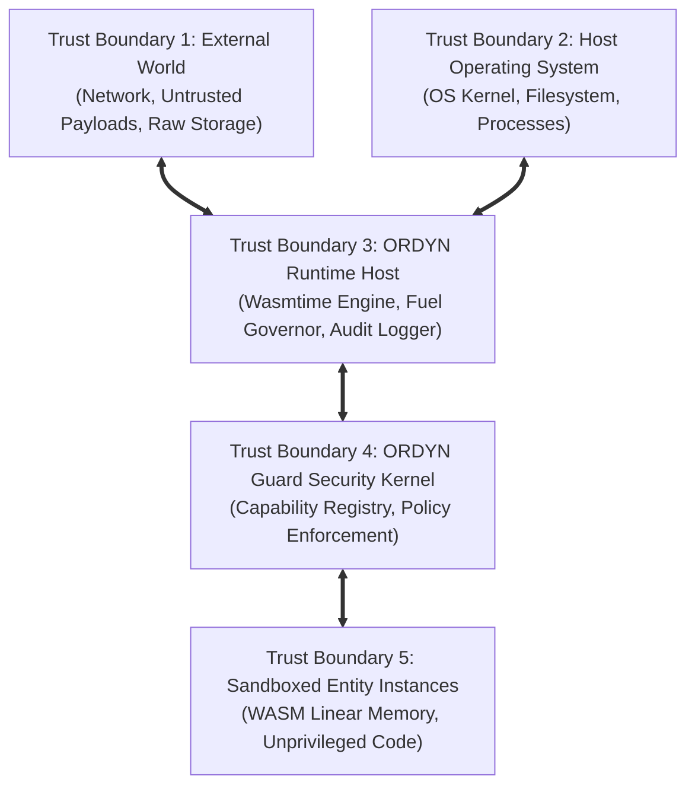

# ORDYN Threat Model

**Classification:** Security Architecture & Threat Risk Assessment  
**Standard:** STRIDE & Zero Trust Capability Model  

---

## 1. Trust Boundaries

ORDYN defines four explicit trust boundaries:

---

## 2. Threat Analysis (STRIDE)

| Threat | Risk Vector | ORDYN Defense Mechanism |
|---|---|---|
| **Spoofing** | Forged identity or synthetic capability handle. | Capabilities are unforgeable 32-bit indices into the Security Kernel's internal table; signed manifests verify module origin. |
| **Tampering** | In-memory modification of code or capability grants. | WASM code section is write-protected at hardware/page level; capability tables live in host kernel memory, outside WASM linear memory. |
| **Repudiation** | Denying an authorized action took place. | Cryptographically verifiable, immutable append-only audit trail recording every granted/denied capability invocation. |
| **Information Disclosure** | Data leakage from confidential state to public sinks. | Static information-flow lattice analysis ($\text{Public} \sqsubseteq \text{Internal} \sqsubseteq \text{Confidential} \sqsubseteq \text{Restricted}$) prevents implicit declassification. |
| **Denial of Service** | Infinite loops, recursion bombs, memory exhaustion. | WASM instruction fuel limits terminate runaway executions deterministically; strict memory allocation ceilings. |
| **Elevation of Privilege** | Code escaping sandbox to make direct host OS calls. | Zero ambient authority; WASM imports only expose audited `ordyn_kernel_*` interfaces. |
